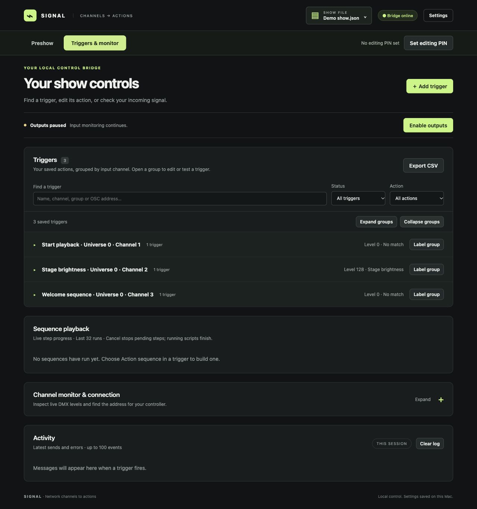
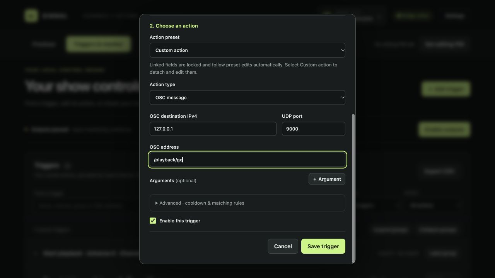
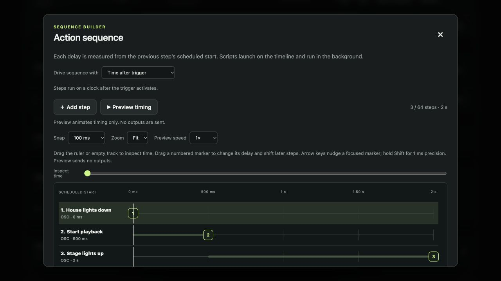
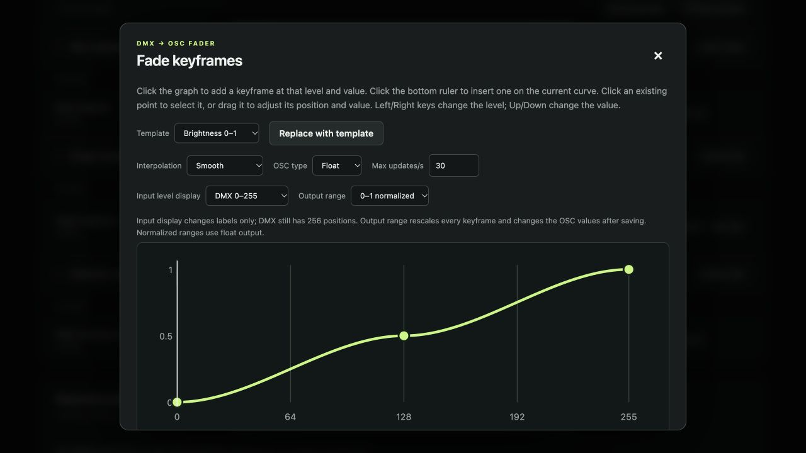

<div align="center">

# Signal

**Turn lighting channels into actions.**

Art-Net, sACN and DDP → OSC, MIDI, scripts and timed sequences.

A local control bridge for macOS, with a browser dashboard and visual cue editors.

**macOS · Python 3.10+ · Works offline · No frontend build required**

[Quick start](#quick-start) · [Your first trigger](#your-first-trigger) · [Troubleshooting](#troubleshooting) · [Full user guide](docs/USER_GUIDE.md)

</div>



_Screenshots use a demonstration show with simulated input. Outputs are paused._

## What you can do

- **Trigger playback:** send an OSC message or MIDI event when a DMX channel enters a chosen range.
- **Follow a fader:** map DMX levels to OSC values with editable keyframe curves.
- **Build a sequence:** arrange OSC, MIDI and script actions on a visual timeline.
- **Run a script:** pass custom fields to a local executable and optionally dispatch selected OSC/MIDI presets from its result.
- **Manage a show:** save reusable presets, label channel groups, search triggers, and export or back up show files.
- **Monitor input:** inspect all 512 channels or just assigned channels, while keeping outputs paused when needed.

Signal runs on your Mac. The main dashboard is local to that computer; lighting data arrives over the network. OSC and scripts use Python’s standard library. MIDI support is an optional installation.

## Quick start

### 1. Get the project and Python

Download the repository using **Code → Download ZIP** on GitHub, then extract it. Keep the project files together, including the `signal_bridge/` and `static/` folders.

Install **Python 3.10 or later** if needed from [python.org](https://www.python.org/downloads/macos/). Check it in Terminal:

```sh
python3 --version
```

### 2. Start Signal

Open Terminal, type `cd `, drag the extracted project folder into the window, and press Return. Then run:

```sh
chmod +x Start.command "Start Preshow.command"
./Start.command --port 8080
```

Open **[http://localhost:8080](http://localhost:8080)** in a browser on the same Mac. Keep the Terminal window open; press **Control+C** there to stop Signal.

You can also double-click **Start.command** in Finder. That uses **[http://localhost](http://localhost)** on port 80 and may ask for your Mac password to open the port. The server then runs as your normal account. Port 8080 avoids that administrator prompt.

<details>
<summary>Prefer running Python directly?</summary>

```sh
python3 app.py --port 8080
```

If you installed MIDI support in the local virtual environment, use:

```sh
.venv/bin/python3 app.py --port 8080
```

</details>

### 3. Connect your lighting controller

1. Put the controller and Mac on the same network.
2. In Signal, open **Settings** and select **Art-Net**, **E1.31 / sACN**, or **DDP** under **Input protocol**.
3. Return to **Triggers & monitor** and expand **Channel monitor & connection**.
4. Use one of the displayed Mac network IPs and the protocol’s UDP port as the controller’s destination. Use `127.0.0.1` only when the sender also runs on this Mac.
5. Match the monitored universe/block to your controller and move a channel. Its level should change in the monitor.

If macOS asks for Python or Terminal to receive incoming connections or access the local network, allow it for your lighting input.

| Input        | UDP port | Universe / block | Channels        |
| ------------ | -------: | ---------------- | --------------- |
| Art-Net      |     6454 | 0–32767          | 1–512           |
| E1.31 / sACN |     5568 | 1–63999          | 1–512           |
| DDP          |     4048 | Blocks 0–255     | 1–512 per block |

**sACN multicast:** set **Mac network IPv4 for multicast** in Settings, or leave `0.0.0.0` for automatic interface selection. Signal joins the monitored universe and enabled trigger universes.

**DDP:** use output ID 1 or 255 and 8-bit channel data, with **Push** on the final packet. Byte offset 512 is **block 1, channel 1**. See the [addressing guide](docs/USER_GUIDE.md#protocol-addressing) for details.

## Your first trigger

This example sends an OSC message when **Art-Net universe 0, channel 1** reaches **100 or higher**.

### Configure the action

1. Click **Pause outputs** while you configure the show.
2. Click **＋ Add trigger**.
3. Name it **Start playback** and set **Universe 0**, **Channel 1**, **Condition ≥ At least**, **Level 100**.
4. Choose **Custom action** and **OSC message**.
5. Enter the destination below, enable the trigger, and click **Save trigger**.

| Field                | Example        | Meaning                                                                              |
| -------------------- | -------------- | ------------------------------------------------------------------------------------ |
| OSC destination IPv4 | `127.0.0.1`    | The receiving application runs on this Mac. Use its network IP if it runs elsewhere. |
| UDP port             | `9000`         | Match the OSC listening port in the receiving application.                           |
| OSC address          | `/playback/go` | An example address. Replace it with an address your receiver supports.               |
| Arguments            | None           | Add typed arguments only if the receiver expects them.                               |



### Verify it

1. Enable OSC reception in the destination application, with the matching port and address.
2. Click **Enable outputs**, then **Test** beside the trigger. Check both **Activity** and the receiving application.
3. Send channel 1 at **0**, then **150**. Signal selects the trigger and sends the action.
4. Hold at 150: it does not repeatedly resend. Return to 0, then raise it again to fire another time.

**“Sent” means Signal handed the message to the operating system; it is not an acknowledgement from the receiver.** If Activity reports a send but nothing happens, check the receiver’s address, port and argument types.

Threshold triggers fire when the selected trigger changes. Overlapping conditions select the narrowest matching range; equal-width ties use saved order. DMX fades and DMX cue followers run independently. See [trigger behavior](docs/USER_GUIDE.md#multiple-triggers-on-one-channel) for examples.

## Choose an action

| Action              | Use it for                                               | Setup                                                              |
| ------------------- | -------------------------------------------------------- | ------------------------------------------------------------------ |
| **OSC message**     | A playback command or parameter update                   | Destination IP, UDP port, OSC address and optional typed arguments |
| **MIDI output**     | Notes, control changes, program changes or transport     | Install MIDI support, then choose an output port and message       |
| **DMX fade → OSC**  | Continuous brightness, color or other numeric control    | Choose keyframes, interpolation and output range                   |
| **Action sequence** | Several cues with delays, or cues crossed by a DMX fader | Build steps in **Edit sequence & timeline**                        |
| **Custom script**   | Local automation or conditional preset dispatch          | Absolute executable path, arguments and session permission         |

### Optional MIDI setup

Run these commands once from the project folder:

```sh
python3 -m venv .venv
.venv/bin/python3 -m pip install -r requirements-midi.txt
```

Restart using **Start.command**, which automatically uses `.venv` when present. Select **MIDI output** in an action and click **Refresh MIDI outputs**. For communication between apps on the same Mac, enable an IAC bus in macOS Audio MIDI Setup and configure your receiver to listen to it.

**Note on does not automatically send Note off.** Add a separate Note off action when needed. [MIDI instructions](docs/USER_GUIDE.md#midi-actions)

### Visual sequence and fade editors

A sequence’s delay is measured from the previous step’s scheduled start. Delays of **0, 500 and 1500 ms** place steps at **0, 0.5 and 2 seconds**. Use **Preview timing** to inspect the timeline without sending outputs. Click **Use sequence**, then **Save trigger** to keep your changes.

A fade maps an incoming DMX level to OSC values. Start with **Brightness 0–1**, **RGB color sweep**, or **Bipolar −1 to 1**. Click **Use fade**, then save the parent trigger or preset.

<details>
<summary><strong>See the visual editors</strong></summary>

**Sequence timeline**



**Fade keyframes**



</details>

[Sequence guide](docs/USER_GUIDE.md#action-sequences-and-visual-timeline) · [Fade guide](docs/USER_GUIDE.md#dmx-faders-and-osc-keyframes) · [Script guide](docs/USER_GUIDE.md#custom-script-actions)

## Save, share and protect your show

- Click the **show filename** in the header to open **Show files**. Edits save automatically to the active JSON file in `shows/`.
- Use **Download show** for a portable backup, **Save a copy** for a variation, or **Upload a show** to import one. Importing, opening or creating a show pauses outputs and disables scripts for that session.
- Use **Settings → Action presets** to reuse action settings. Linked triggers follow preset edits automatically; select **Custom action** to detach a trigger.
- Use **Export CSV** to download your configured channel assignments. This is a reference export; use JSON to back up the complete show.
- Use **Set editing PIN** to protect configuration changes while leaving monitoring, testing and output pause available.

Want to explore the screenshot examples? Download [demo-show.json](examples/demo-show.json) and import it through **Show files → Upload a show**. Its OSC destinations are loopback examples; configure them for your receiver before enabling outputs.

Script executables are separate files and are **not** included in show downloads. Transfer them separately and update their paths on another Mac. [Show file details](docs/USER_GUIDE.md#show-files-and-backups)

## Optional preshow controller

The separate preshow page tracks whether you are in preshow and can start a saved MIDI trigger or timed action sequence. To pair it with the port-8080 setup above, open another Terminal in the project folder and run:

```sh
./"Start Preshow.command" --bridge-url http://127.0.0.1:8080
```

Open **[http://localhost:8081](http://localhost:8081)**. The default start action looks for a trigger named **Start Preshow** in the active Signal show; configure that trigger before using the button. Use `--preshow-trigger "Your cue name"` to choose another supported trigger.

The preshow server also accepts OSC `/preshow` on UDP port 9000. Its default web listener accepts LAN connections; add `--host 127.0.0.1` for access only from this Mac. See [PRESHOW.md](PRESHOW.md) for setup, status API, and the conditional FPP gate script.

## Troubleshooting

| Symptom                                     | Check                                                                                                                                                                |
| ------------------------------------------- | -------------------------------------------------------------------------------------------------------------------------------------------------------------------- |
| Dashboard will not open                     | Keep the launch Terminal open, check its error, and use the URL for the chosen web port. Try `./Start.command --port 8080`.                                          |
| No channel levels                           | Check the selected input protocol, controller destination IP, UDP port and universe/block. Expand **Channel monitor & connection**; check macOS network permissions. |
| Receiver port is already in use             | Stop another instance or application using that UDP port. The selected input’s receiver error appears in the monitor.                                                |
| OSC is “sent” but the receiver does nothing | Match the receiver’s listening port, supported address and typed arguments. `127.0.0.1` only reaches this Mac.                                                       |
| Holding a channel does not repeat an action | This is expected. Move outside the condition, then back inside it. Also check cooldown and overlapping ranges.                                                       |
| New show does not fire                      | Loaded, imported and new shows start paused. Click **Enable outputs**, then move the channel out of its condition and back in.                                       |
| MIDI port missing or unavailable            | Install the optional packages, connect the device or enable an IAC bus, launch with `.venv`, then refresh MIDI outputs.                                              |
| Script will not run                         | Allow scripts for the session in Settings. Check the absolute executable path, executable permissions, arguments and timeout.                                        |
| Changes are blocked                         | Click **Unlock editing** and enter the PIN. Reloading drops the page’s editing access.                                                                               |
| Preshow page cannot start its cue           | Run both servers, match `--bridge-url` to Signal’s web port, check the trigger name, and enable outputs.                                                             |
| Python changes do not appear                | Stop and restart Signal, then refresh the browser. Refreshing alone reloads the frontend, not the Python server.                                                     |

## Documentation and development

- [Full user guide](docs/USER_GUIDE.md) — protocol addressing, presets, scripts, fades, sequences, timing and limits.
- [Preshow guide](PRESHOW.md) — controller setup, OSC status and FPP gate integration.
- [Code map](ARCHITECTURE.md) — backend modules and browser files.

Run the tests from the project folder:

```sh
python3 -m unittest discover -s tests -v
node --test tests/*.cjs
```

Node.js is used for the JavaScript tests, not to run the dashboard. Tests use loopback and mocks; verify your physical controller and connected applications before a show.

Signal supports one sender per universe and does not merge sources or arbitrate sACN priorities. It is a trigger and control bridge with best-effort timing. See [scope and limits](docs/USER_GUIDE.md#scope-and-verification) for protocol details.
